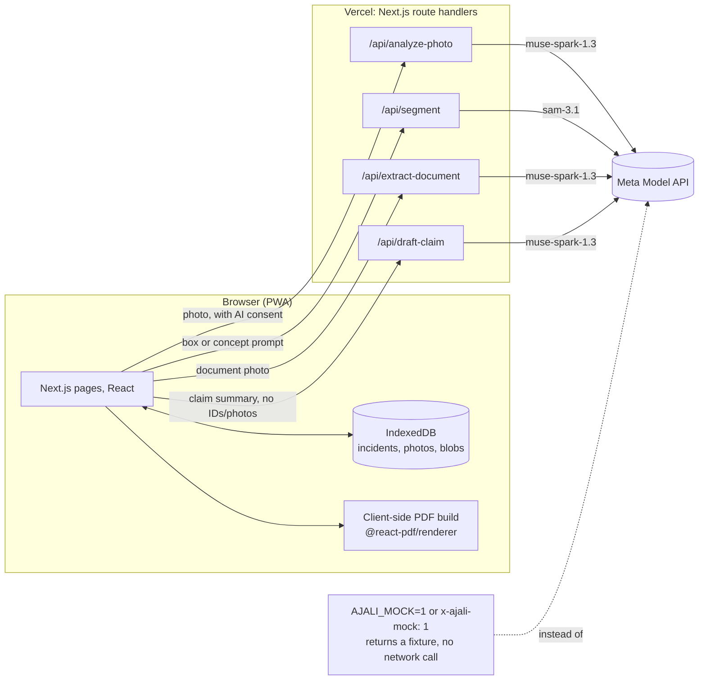

# Ajali Kit

Ajali Kit helps a motorist in Kenya build a motor insurance claim pack after an accident. "Ajali" means
accident in Swahili. It guides you through a safety check, the photos and details your insurer needs, uses
AI to mark damage on your own photos, then puts everything into one PDF you share yourself.

Built for a hackathon on Meta's Model API. It is a mobile-first installable web app (PWA), not a native app,
so a judge or an insurer can open it from a plain URL.

## What it does

1. Safety check, then an incident record with the time and place.
2. A guided photo checklist (own damage, other vehicle, scene, documents).
3. AI damage check: Muse Spark finds and describes each damaged part on a photo, SAM 3.1 traces the exact
   damaged area and the outline of the vehicle. You review, edit or delete every item before anything is
   used.
4. Scan the other driver's licence, logbook and insurance certificate; Muse Spark reads the fields into a
   form you check and confirm.
5. A police report and witness section.
6. Muse Spark turns your own words into a clear claim account, and flags contradictions between what you
   said and the damage on file (for example, "hit from behind" against front-only damage).
7. One PDF claim pack: cover, account, damage schedule with annotated photos, other party and police
   details, a checklist of what the insurer may still ask for. Share, download or email it yourself.

Everything stays on your phone. A photo or document is only sent to Meta's AI to analyse it, and only once
you agree.

## Meta models used

| Model | Used for |
| --- | --- |
| **Muse Spark 1.3** (`/api/analyze-photo`) | Looks at one damage photo and returns a structured list of damaged parts (part, damage type, an indicative severity, a short description, a bounding box), plus whether the photo shows a vehicle and which side. |
| **Muse Spark 1.3** (`/api/extract-document`) | Reads a photo of a driving licence, logbook or insurance certificate and returns the fields it can read, each with a confidence level, so low-confidence fields get flagged for the user to check. |
| **Muse Spark 1.3** (`/api/draft-claim`) | Turns the user's own words plus the confirmed facts already on file (no names, IDs, phone numbers or photos, see Privacy below) into a claim account, a damage schedule, a list of items the insurer will probably ask for, consistency warnings, and clarifying questions. Never estimates a repair cost or decides fault. |
| **SAM 3.1** (`/api/segment`) | Given a box from Muse Spark's analysis (or a "car" concept prompt), traces the exact pixel mask of that damaged area, or of the whole vehicle, so the claim pack shows how much of the vehicle is affected, not just a label. |

All four calls go through server route handlers under `src/app/api/`. The browser never calls
`api.meta.ai` directly, and the API key never reaches the client bundle (see Privacy and security below).

## Mock mode

Every AI route returns a realistic fixture instead of calling the Meta Model API when mock mode is on, so
the UI can be built and tested without spending API credits. Mock mode is on when:

- the server env var `AJALI_MOCK=1` is set, or
- a request carries the header `x-ajali-mock: 1`.

Fixtures are built from the real request where it makes sense (for example, the mock claim draft names the
incident's own real location, time and confirmed damage items, and reproduces the same consistency-warning
heuristic a real call would trigger). Unit tests never make a network call and never need `MODEL_API_KEY`.

## Setup

Requires Node 22.x (`^20.17.0` or `>=22.9.0`, for `@meta-sam/parser`).

```bash
npm install
cp .env.example .env.local   # fill in MODEL_API_KEY for real AI calls, or set AJALI_MOCK=1 to skip that
npm run dev                  # http://localhost:3000, or open the LAN address on your phone
```

## Scripts

```bash
npm run dev            # local dev server
npm run build           # production build check
npm start               # run the production build
npm run lint             # eslint
npm run typecheck        # tsc --noEmit
npm test                 # vitest, no network calls
npm run gen-icons        # regenerate PWA icons from the source logo
npm run e2e:smoke        # headless Chrome smoke run against a running dev server, mock mode
```

`npm run e2e:smoke` needs a dev server already running in mock mode (`AJALI_MOCK=1`) at `E2E_BASE_URL`
(default `http://localhost:3100`), a system Chrome at `CHROME_PATH` (default `/usr/bin/google-chrome`), and
`playwright-core`. It walks the full flow (safety check, photos, AI damage review, other party, police,
witnesses, claim draft, PDF build and download, the printable fallback) and writes screenshots and the
downloaded PDF to `e2e-output/` (gitignored). The fixture photo it uploads
(`scripts/e2e/fixtures/car.jpg`) is a tiny synthetic JPEG, not a real photo.

## Environment variables

See `.env.example`. Copy it to `.env.local`, which is git-ignored and never committed.

| Variable | Default | Notes |
| --- | --- | --- |
| `MODEL_API_KEY` | (empty) | Meta Model API key. Server only, never sent to the browser, never logged. |
| `META_BASE_URL` | `https://api.meta.ai/v1` | |
| `MUSE_MODEL` | `muse-spark-1.3` | Standard mode only, not a `-contributor` model. |
| `SAM_MODEL` | `sam-3.1` | Standard mode only. |
| `AJALI_MOCK` | `0` | `1` makes every AI route return a fixture. |
| `NEXT_PUBLIC_SHOW_DEV` | `0` | `1` shows the Settings page's dev tools (mock mode indicator, demo incident button). |
| `NEXT_PUBLIC_MOCK_MODE` | `0` | Mirrors `AJALI_MOCK` for that indicator; a server env var is not visible in the browser. Not a secret either way. |

## Architecture



The server holds the API key and is otherwise stateless: it never stores a photo, a document or the claim
data. Everything the user enters lives in IndexedDB on their own phone. The finished PDF is built in the
browser too, from that same data, and never uploaded; it is not itself kept in IndexedDB, so re-opening the
claim pack screen rebuilds it from the incident and its photos rather than reloading a saved file.

## Privacy and security

- **Local first.** Incidents, photos and documents live in IndexedDB on the phone; the claim pack PDF is
  built from them in the browser each time rather than stored separately. "Delete all data" in Settings, or
  deleting one incident, removes its photos and blobs from the device.
- **Explicit AI consent** per incident, asked once, before any photo or document is sent to the Meta Model
  API.
- **Standard mode only.** `muse-spark-1.3` and `sam-3.1`, never a `-contributor` model, since these calls
  carry a user's own photos and documents.
- **Minimum data sent to the model.** The claim draft call never includes names, ID numbers, phone numbers,
  registrations, the police OB number text, witness names or phone numbers, GPS coordinates or any photo;
  a fact the model only needs to know exists (for example, "an OB number is on file") is sent as a boolean.
  Free-text fields are scanned and redacted for anything that looks like a phone number, plate or ID number
  before they are sent. Document extraction sends only the document photo it was asked to read.
- **No API key in the client bundle.** `MODEL_API_KEY` is read only in server route handlers; the
  production build output has been checked and contains no match for it. `.env.local` is git-ignored.
- **No logging of personal data or image bytes.** Server routes log only the model name, latency, token
  usage and an error code.
- **Witness consent** before their phone number is included in the PDF.
- **No insurer names or logos** anywhere in the app. "Your insurer" wording only; a user's own saved insurer
  name (My vehicle) stays local to their device.
- **No repair cost estimates and no fault decisions**, anywhere in the app or in any prompt sent to the
  model. Severity is always described as indicative, and AI-found damage areas as a guide the user checks.
- Under Kenya's Data Protection Act, 2019, the user controls their own data and can delete it at any time
  (a general statement, not legal advice).

## Known limits

- No repair cost estimates, no fault decisions: by design, not a missing feature.
- AI damage marks are a guide the user reviews; they are not a certified assessment.
- Mask raster size versus the box it was requested on is not documented by SAM 3.1 for large objects; this
  build measures and scales each mask rather than assuming a fixed relationship, but has not been checked
  against every possible real photo size.
- No offline queue for AI calls: the damage check, document scan and claim draft need a connection (the app
  shows an offline banner); everything else, including building the PDF, works from what is already saved.
- Built for a hackathon's three-day timebox. See `PLAN.md` for the features cut to make that deadline and
  `PROGRESS.md` for a running log of what shipped in each phase.

## License

MIT, see `LICENSE`.
